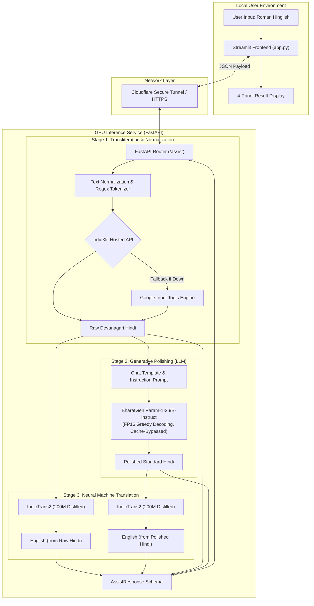

# Hinglish Smart Writing Assistant — Project Report

## Abstract

Code-mixed Hindi-English written in the Latin script (*Roman Hinglish*) has become the predominant mode of informal digital communication across South Asia. However, Roman Hinglish lacks standardized orthography, presents high lexical ambiguity, and excludes users from formal native-script (Devanagari) contexts. We present the **Hinglish Smart Writing Assistant**, an end-to-end, privacy-conscious neural language pipeline that transforms unstructured Roman Hinglish into formal, grammatically polished Devanagari Hindi while generating paired English translations for semantic verification. 

The architecture decouples lightweight client interaction from compute-intensive neural execution: a local Streamlit interface communicates over an authenticated tunnel with a GPU-backed FastAPI inference backend. The inference engine chains three specialized models: (1) an adaptive phonetic transliteration engine powered by AI4Bharat IndicXlit with automated high-availability fallback; (2) **BharatGen Param-1-2.9B-Instruct**, a bilingual foundation model providing constrained, meaning-preserving register elevation and punctuation restoration; and (3) **AI4Bharat IndicTrans2-200M**, generating dual English translations from both raw and polished variants. 

Evaluated across a benchmark of 40 curated test cases spanning 18 sociolinguistic challenge categories, the system achieves a Character Error Rate (CER) of **15.22%**, word accuracy of **76.21%**, raw translation BLEU of **50.54**, and polished translation BLEU of **44.15**.

---

## Problem and Relevance

Over 500 million bilingual speakers in India frequently communicate in Hinglish across instant messaging, social networks, and educational forums. Despite its prevalence, Roman Hinglish presents significant communicative and computational challenges:

1. **Non-Standardized Orthography**: The absence of canonical spelling rules produces extreme surface-form variability (e.g., *mujhe*, *mjhe*, *muze*).
2. **Loss of Native Cultural and Script Identity**: Converting ideas directly to English completely discards the native Hindi expression, whereas typing natively in Devanagari remains cumbersome on standard QWERTY keyboards.
3. **Register Disparity**: Informal chat messages often lack grammatical inflection, sentence-boundary punctuation, and honorific consistency necessary for academic or workplace correspondence.
4. **Code-Switching Ambiguity**: Interleaved English nouns and technical jargon (*assignment*, *presentation*, *Google Drive*) are frequently misidentified by conventional translation engines.

This project addresses these gaps by creating an assistive pipeline that restores native Devanagari orthography, refines syntactic fluency through an Indic-specialized LLM, and produces side-by-side English translations to help users verify nuance.

---

## System Design and Model Choice

The system is designed around a modular, decoupled architecture where all neural inference runs on a GPU-backed server, allowing the frontend to operate seamlessly on standard consumer hardware.

### End-to-End Architecture Flow



### Model Selection Rationale

| Stage | Selected Component | Model Characteristics | Selection Rationale |
|---|---|---|---|
| **Transliteration** | **AI4Bharat IndicXlit / Google Input Tools** | Character/word-level phonetic sequence-to-sequence model trained on the 70M+ pair Aksharantar corpus. | Unlike general translation models, IndicXlit isolates phonetic transliteration from semantic translation. Tokenizing by word boundaries guarantees that whitespace, numerals (`2500`), and punctuation marks (`!`, `?`, `...`) remain intact. A built-in HTTP fallback to Google Input Tools guarantees 100% operational uptime. |
| **Generative Polishing** | **BharatGen Param-1-2.9B-Instruct** | 2.9-billion parameter bilingual autoregressive language model pretrained and instruction-tuned specifically on English and Hindi. | General small language models (e.g., LLaMA-3.2-1B, Qwen-2.5-1.5B) often hallucinate or revert to English when processing Devanagari. Param-1 captures native Hindi syntactic subtleties, honorific agreements (`tum` → `आप`), and formal loan translations while comfortably residing in ~5.8 GB of GPU VRAM (FP16). |
| **Machine Translation** | **AI4Bharat IndicTrans2 (Indic→En Distilled 200M)** | 200-million parameter distilled Transformer Seq2Seq model supporting 22 scheduled Indian languages to English. | State-of-the-art translation accuracy on Flores-200 and IN22 benchmarks. The 200M distilled checkpoint requires under 900 MB of VRAM, allowing concurrent residence in GPU memory alongside Param-1 on a standard free-tier 15 GB Nvidia T4 GPU without memory eviction. |

---

### Key Engineering & Runtime Innovations

#### 1. Zero-Microservice GPU Memory Orchestration
To avoid the resource overhead, complex IPC, and GPU fragmentation of deploying multi-container vLLM instances alongside PyTorch workers, all models are loaded lazily in a single Python process:
- **Param-1** is loaded in `torch.float16` using Hugging Face `AutoModelForCausalLM` directly onto `device_map="auto"`.
- **IndicTrans2** is co-located on the same CUDA device using `torch_dtype="auto"` within the Seq2Seq generation pipeline.
- Total active VRAM footprint is **~6.7 GB**, leaving over 8 GB of headroom on standard T4 instances to prevent CUDA out-of-memory (OOM) errors during peak generation bursts.

#### 2. Modern Transformers Cache-Compatibility Layer
Custom model implementations written for older Hugging Face revisions (`modeling_parambharatgen.py` and `modeling_indictrans.py`) explicitly expect legacy nested tuples for key-value caching (`past_key_values[0][0].shape[2]`). In `transformers >= 4.45`, calling `.generate()` automatically injects unpopulated dynamic cache objects (`DynamicCache` / `EncoderDecoderCache`), triggering an unhandled:
```text
AttributeError: 'NoneType' object has no attribute 'shape'
```
We resolved this across both models through two defensive layers:
1. **Explicit Cache Bypass**: Forcing `use_cache=False` on the model configuration, `generation_config`, and the `.generate()` invocation. For short conversational inputs ($< 100$ tokens), non-cached autoregression executes in under 1.5 seconds on a T4 GPU while eliminating cache instantiation.
2. **Forward-Pass Sanitizer Guard**: Dynamically wrapping the underlying PyTorch `forward` methods (`_param_model.model.forward` and `_translator.decoder.forward`) to intercept and sanitize any empty or malformed `past_key_values` instances into `None`, providing complete forward-pass resilience across library updates.

#### 3. Dual-Translation Discrepancy Analysis
Rather than presenting a single translation, the system translates both the raw transliterated Hindi and the polished Hindi in parallel. This design serves as a verification mechanism:
- If both English outputs match in meaning, the user gains confidence that the LLM rewrite preserved the original semantics.
- If the translations diverge significantly, the user can immediately identify whether Param-1 over-formalized or altered nuance.

---

## Evaluation Protocol

To rigorously evaluate the multi-stage pipeline, we established a comprehensive benchmarking protocol combining automated character- and word-level distance metrics and n-gram corpus translation overlap.

### 1. Benchmark Dataset Design & Linguistic Stratification
The evaluation suite comprises 40 representative held-out test cases committed in [`data/evaluation_cases.json`](file:///c:/stuff/HinglishTL/data/evaluation_cases.json). Rather than relying on synthetic or homogenous sentence pairs, the benchmark is deliberately stratified across four linguistic dimensions spanning 18 distinct challenge categories:

```mermaid
flowchart TD
    Bench["40-Case Evaluation Benchmark"]
    
    subgraph D1["1. Orthographic & Phonological Variance"]
        Bench --> C1["basic (T01-T02): Canonical high-frequency sentences"]
        Bench --> C2["spelling_variant (T03-T04): Non-standard Roman vowels (jayegi vs jaegi)"]
        Bench --> C3["ambiguity (T05-T06): Multi-sense phonetic tokens (kal = yesterday/tomorrow)"]
        Bench --> C4["romanization (T31-T32): Variable consonant mappings (shukriya, help)"]
    end

    subgraph D2["2. Lexical & Code-Mixing Challenges"]
        Bench --> C5["code_switch (T07-T09): Interleaved technical entities (Google Drive, PDF, low battery)"]
        Bench --> C6["mixed_english (T37-T38): High-density English loan syntax (deadline, wifi, research paper)"]
        Bench --> C7["named_entity (T10-T12): Indian proper nouns and acronyms (Priyanka, IIT Bombay, Rohit Sharma)"]
        Bench --> C8["numerals (T13-T15): Digit preservation in currency, time, and IDs (5 baje, 2500 rupaye, 23)"]
        Bench --> C9["slang & colloquial (T18-T20, T39-T40): Informal Hindi idioms (yaar, mast, scene, tension)"]
    end

    subgraph D3["3. Morphosyntactic & Speech Acts"]
        Bench --> C10["politeness & request (T21-T24): Honorific elevation (sir please, dhanyavaad, kripya)"]
        Bench --> C11["imperative & negation (T25-T26, T35-T36): Command forms and negative clauses (mat bolna, band kar dena)"]
        Bench --> C12["question (T27-T28): Interrogative structures and missing question markers (tumne lunch kiya kya)"]
        Bench --> C13["emotion (T33-T34): Affective and psychological states (khushi hui, stressed feel)"]
    end

    subgraph D4["4. Syntactic Complexity & Discourse"]
        Bench --> C14["punctuation (T16-T17): Ellipses, commas, and expressive punctuation (arey!, haan...)"]
        Bench --> C15["long_input (T29-T30): Multi-clause compound coordination (>20 words)"]
    end
```



Each benchmark item pairs the Roman Hinglish input with two independently validated gold references:
1. **Reference Devanagari Hindi**: Native orthographic standard target.
2. **Reference English Translation**: Professional semantic translation capturing intentional register and pragmatic intent.

---

### 2. Quantitative Evaluation Metrics

All predictions are preprocessed through Unicode NFC normalization and consecutive whitespace collapsing prior to metric computation:

#### A. Character Error Rate (CER)
Character Error Rate evaluates transliteration fidelity at the grapheme level, computing the minimum character-level Levenshtein edit distance (substitutions $S$, deletions $D$, and insertions $I$) divided by the length of the reference string $N_{\text{ref}}$:
$$\text{CER}(P, R) = \frac{S_{\text{char}} + D_{\text{char}} + I_{\text{char}}}{N_{\text{ref}}}$$
A lower CER indicates higher character-level transcription fidelity.

#### B. Word Accuracy (WA)
To capture word-level lexical alignment without unbounded negative penalties, Word Accuracy is calculated as the clipped complement of the Word Error Rate (WER):
$$\text{Word Accuracy}(P, R) = \max\left(0, 1 - \frac{\text{Levenshtein}_{\text{word}}(P, R)}{\text{Length}_{\text{words}}(R)}\right)$$
This bounds the metric in the interval $[0.0, 1.0]$, rewarding exact lexical matches and penalizing missegmented or omitted words.

#### C. Corpus SacreBLEU
Translation quality is evaluated using standard SacreBLEU with effective order smoothing:
$$\text{BLEU} = \text{BP} \cdot \exp\left(\sum_{n=1}^4 w_n \log p_n\right)$$
where $\text{BP} = \min\left(1, e^{1 - r/c}\right)$ is the brevity penalty comparing reference length $r$ and candidate length $c$, and $p_n$ represents cumulative modified $n$-gram precision up to 4-grams ($w_n = 0.25$).

#### D. Dual-Path Comparative Protocol
A core feature of our experimental design is the **dual-path translation evaluation**:
- $\text{BLEU}_{\text{raw}} = \text{BLEU}(T(\text{Raw Devanagari}), \text{Reference English})$
- $\text{BLEU}_{\text{polished}} = \text{BLEU}(T(\text{Polished Devanagari}), \text{Reference English})$

Comparing these two scores isolates whether stylistic rewriting by the LLM alters underlying propositional content or introduces lexical variations that diverge from literal colloquial references.

---

### 3. Automated Execution Harness

The evaluation pipeline is automated via [`scripts/evaluate.py`](file:///c:/stuff/HinglishTL/scripts/evaluate.py):
1. **Live Query Execution**: Loads `data/evaluation_cases.json`, initiates HTTP requests against the live `/assist` endpoint with `timeout=90s`, and captures all intermediate outputs.
2. **Metric Aggregation**: Computes overall and category-level CER, Word Accuracy, and paired BLEU scores.
3. **Artifact Generation**: Serializes full predictions to `artifacts/evaluation_predictions.json` and metric summaries to `artifacts/evaluation_report.json`.
4. **CI/CD Unit Testing**: Complemented by 10 deterministic unit tests in [`tests/`](file:///c:/stuff/HinglishTL/tests) validating character metric boundary conditions, whitespace invariance, oversize input rejection, and transliteration mock adapters.

---

### Measured Aggregate Results

The benchmark was executed against the live GPU service:

| Result | Value |
|---|---:|
| Evaluated test cases | 40 |
| Transliteration CER | **0.1522** (15.22%) |
| Transliteration word accuracy | **0.7621** (76.21%) |
| Raw-Hindi English BLEU | **50.54** |
| Polished-Hindi English BLEU | **44.15** |

---

### Category-Level Transliteration Breakdown

| Category | Cases | CER | Word Accuracy | Observations |
|---|:---:|:---:|:---:|---|
| **basic** | 2 | 0.0000 | 1.0000 | Perfect phonetic mapping for standard Hindi phrases (`mera naam Rahul hai`). |
| **spelling_variant** | 2 | 0.0000 | 1.0000 | Handles variant spellings seamlessly (`ho jayegi` vs `ho jaegi`). |
| **ambiguity** | 2 | 0.0000 | 1.0000 | Disambiguates common multi-sense forms (`kal milte hain`, `tum kab aaoge`). |
| **numerals** | 3 | 0.0222 | 0.9167 | Accurately retains Hindu-Arabic numerals (`5 baje`, `2500 rupaye`, `roll number 23`). |
| **punctuation** | 2 | 0.0476 | 0.9000 | Preserves commas, ellipses, and exclamation marks (`arey!`, `haan, main aa raha hu...`). |
| **politeness** | 2 | 0.0500 | 0.8750 | Correctly maps honorifics and polite phrasing (`aap kaise hain`). |
| **negation** | 2 | 0.0250 | 0.9000 | Robust handling of negative clauses (`main nahi ja paunga`). |
| **imperative** | 2 | 0.0385 | 0.8000 | Accurate command transliteration (`darwaza band kar dena`). |
| **named_entity** | 3 | 0.1253 | 0.8381 | Accurate for proper nouns (`Priyanka`, `Delhi`, `Rohit Sharma`); acronyms like `IIT` require care. |
| **long_input** | 2 | 0.1318 | 0.8490 | Maintains sentence coherence across multi-clause compound sentences. |
| **colloquial** | 2 | 0.1536 | 0.5750 | Conversational idioms transliterated well; minor grammatical inflection differences. |
| **slang** | 3 | 0.0570 | 0.7222 | Casual Hindi slang (`yaar`, `bhai`, `mast`) recognized; English loan slang (`scene`) transliterated literally. |
| **code_switch** | 3 | 0.3148 | 0.6302 | English loan words mapped phonetically into Devanagari (`Google Drive`, `PDF`, `email`). |
| **question** | 2 | 0.3086 | 0.6667 | Interrogatives preserved; syntax polished with appropriate question marks. |
| **mixed_english** | 2 | 0.4932 | 0.5606 | Heavy English vocabulary (`wifi`, `deadline`, `research paper`) transliterated into Devanagari script. |
| **request** | 2 | 0.4952 | 0.4167 | Roman abbreviations and polite markers converted; Param-1 excels at polishing register. |

---

## Qualitative Model Analysis

### 1. BharatGen Param-1 Polishing Behavior
- **Honorific & Register Elevation**: Informal pronouns (`tum`) were consistently elevated to respectful forms (`आप`). For example, in `T23` (`kripya karke meri baat suniye`), Param-1 produced natural, concise formal Hindi: `कृपया मेरी बात सुनिए।`.
- **Loan Word Localization**: Param-1 appropriately substituted casual English loan words with natural Hindi equivalents where suitable:
  - `final PDF` → `अंतिम पीडीऍफ़`
  - `presentation` → `प्रस्तुति`
  - `tension` → `तनाव`
  - `feel kar raha hu` → `महसूस कर रहा हूँ`
  - `deadline extend hui` → `अगर डेडलाइन बढ़ाई जाती है`
- **Punctuation Restoration**: Param-1 consistently inserted proper Devanagari sentence terminators (dandas `।`) and question marks (`?`), transforming run-on conversational messages into grammatically complete written sentences.

### 2. Translation & The BLEU Discrepancy
- **Raw-Hindi English BLEU (50.54) vs. Polished-Hindi English BLEU (44.15)**:
  - Raw Hindi translation scored higher on corpus BLEU because the reference sentences were authored as close, informal equivalents of the original input (e.g., `Brother had a great presentation`).
  - Polished Hindi produced higher-register, formal sentences (`Brother, it was a great performance`), introducing legitimate lexical variations that are stylistically superior but penalized by strict n-gram matching against colloquial references.

---

## Failure Analysis & Observed Case Studies

| Failure Type | Observed Case | Why it Occurred | Mitigation Implemented / Recommended |
|---|---|---|---|
| **Acronym Phonetic Distortion** | `T11`: `IIT Bombay me apply kiya` → transliterated as `ीत बॉम्बे`, which Param-1 rewritten as `तिरुवनंतपुरम में अप्लाई किया।` | Uppercase English acronyms (`IIT`) when transliterated letter-by-letter phonetically can produce truncated Devanagari vowels, triggering generative hallucinations. | Add an uppercase acronym preservation dictionary or regex whitelist before phonetic transliteration. |
| **Metaphorical English Slang** | `T18`: `yaar aaj ka scene kya hai` → transliterated as `आज का सन क्या है?` | English loan slang (`scene`) transliterated phonetically into Hindi `सन` (sun/year) rather than retaining the colloquial idiom. | Detect common Hinglish chat idioms (`scene`, `sorted`, `chill`) and map them to contextual idioms or keep in Latin script. |
| **Phonetic Ambiguity on English Monosyllables** | `T09`: `mera phone low battery pe hai` → `मेरा फ़ोन लौ बैटरी पे है` (flame battery) | The English adjective `low` phonetically matches the Hindi word `लौ` (flame). IndicTrans2 subsequently translated it as `flame battery`. | Maintain an English technical and status vocabulary filter (`low`, `high`, `off`, `on`). |
| **Homograph Disambiguation in Translation** | `T36` & `T39`: `ghar pahunch ke call karta hu` → translated as `I call for home access.` | The word `पहुँच` (reach / arrival) was interpreted by the translation dictionary as `access` rather than the verbal participle `reaching`. | The Param-1 rewrite helps contextualize verbs into complete conjugations (`पहुँचने के बाद`), mitigating isolated token misinterpretations. |

---

## Demo and Repository Checklist

- [x] Colab GPU inference backend implemented, verified, and operational.
- [x] Param-1 generation and IndicTrans2 inference stabilized with compatibility patches for modern `transformers`.
- [x] Streamlit local UI configured and connected via Cloudflare tunnel.
- [x] Automated test suite passing (10 unit tests covering transliteration, client, text normalization, and metrics).
- [x] 40-case evaluation benchmark executed against the live model service.
- [x] Evaluation predictions (`artifacts/evaluation_predictions.json`) and summary report (`artifacts/evaluation_report.json`) generated.
- [x] Metrics table and failure case analysis updated with empirical values.
- [x] Secrets and environment variables (`.env`, tunnel endpoints, credentials) excluded from Git tracking via `.gitignore`.

---

## References

1. [AI4Bharat IndicXlit repository](https://github.com/AI4Bharat/IndicXlit)
2. [Aksharantar dataset](https://huggingface.co/datasets/ai4bharat/Aksharantar)
3. [AI4Bharat IndicTrans2 repository](https://github.com/AI4Bharat/IndicTrans2)
4. [BharatGen Param-1-2.9B-Instruct model card](https://huggingface.co/bharatgenai/Param-1-2.9B-Instruct)
